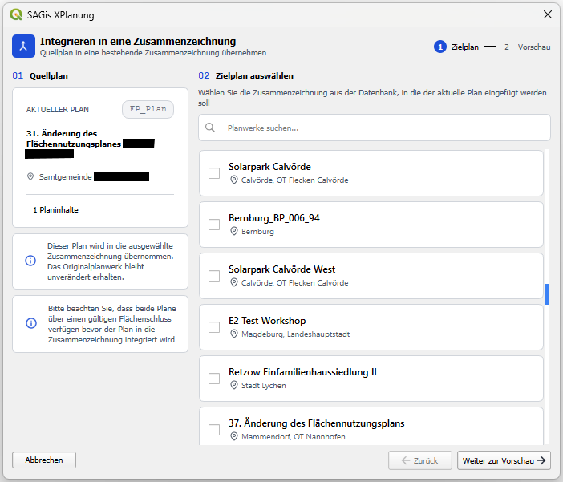
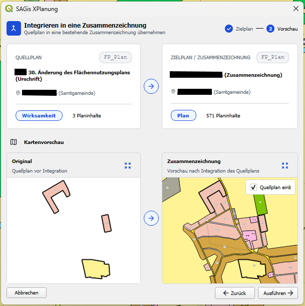

# Plan in eine Zusammenzeichnung integrieren

Mit der Funktion **Plan in Zusammenzeichnung integrieren** können die Inhalte eines Planwerks (Quellplan) in ein
anderes Planwerk (Zielplan) übernommen werden. Der Quellplan bleibt dabei unverändert erhalten; seine Bereiche und
alle darin enthaltenen Planinhalte werden vollständig in den Zielplan kopiert.

!!! note "Was ist eine Zusammenzeichnung?"

    Im Kontext des Standards XPlanung bezeichnet eine **Zusammenzeichnung** die Zusammenführung der Urschrift eines Plans
    mit allen seinen bisherigen Änderungen und Berichtigungen zu einem einzigen, aktuellen Planwerk. Der Vorteil einer
    Zusammenzeichnung ist, dass alle aktuell gültigen Inhalte eines Plans in einem einzigen Datensatz abgebildet werden.
    Dies betrifft in der Praxis insbesondere Flächennutzungspläne, bei denen Änderungen über lange Zeiträume hinweg
    anfallen. Aus einer Zusammenzeichnung kann anschließend eine neue Fassung erzeugt werden, die durch einen
    anschließenden Beschluss der Kommune zur Neuaufstellung des FNP dient. Nachteil einer Erfassung in Form einer Zusammenzeichnung 
    ist, dass die Historie der Änderungen verloren geht und die ehemalige Planungsabsicht der Kommune in XPlanung nicht mehr 
    nachvollzogen werden kann.

    ??? plain "Weitere Informationen"

        - BY: [Leitfaden Digitale Bauleitpläne](https://www.digitale.planung.bayern.de/medien/dokumente/leitfaden_xplanung.pdf#page=52), Kap. 6.2 "Erfassung überplanter Bereiche in Bestandsplänen" u. Kap. I.5.1 "Zusammenzeichnung"

## Funktionsweise

Die Funktion dient dazu, ein vollständiges Planwerk in ein anderes, bereits vorhandenes Planwerk zu integrieren.
Dabei führt SAGis XPlanung automatisch die folgenden Schritte aus:

1. **Übernahme der Planinhalte:** Alle Bereiche des Quellplans werden zusammen mit allen enthaltenen Planinhalten
   in den Zielplan kopiert. Die Objekte erhalten neue Identifikationen und der Quellplan bleibt unverändert bestehen.
2. **Anpassung überlappender Inhalte:** Überlagern sich die Geltungsbereiche beider Pläne, werden die im Überlappungsbereich
   liegenden Planinhalte des Zielplans entsprechend zurückgeschnitten, sodass der [Flächenschluss](elements/plan-details.md#geometrieprufung)
   erhalten bleibt.
3. **Erweiterung des Geltungsbereichs:** Reicht der Quellplan über den Geltungsbereich des Zielplans hinaus, wird der
   Geltungsbereich des Zielplans automatisch auf die vereinigte Fläche erweitert.

## Dialog aufrufen

    <h4>Zusammenzeichnungs-Dialog öffnen</h4>
    <ol>
        <li>Gewünschtes Planwerk (Quellplan) in der [Detailansicht Planwerk](elements/plan-details.md) öffnen</li>
        <li>
            Im oberen Abschnitt des Fensters das Menü mit den drei Punkten (<b>⋮</b>) anklicken
            <figure>
                
            </figure>
        </li>
        <li>Die Aktion <b>Plan in Zusammenzeichnung integrieren</b> wählen</li>
    </ol>

## Vorgehensweise zum Integrieren eines Plans

Der Dialog führt in drei Schritten durch die Zusammenzeichnung. Über die Schaltflächen **Abbrechen** und **Zurück**
kann der Vorgang jederzeit abgebrochen bzw. ein Schritt zurückgegangen werden.

### Schritt 1: Zielplan auswählen

Im linken Bereich werden Informationen zum **Quellplan** angezeigt

Im rechten Bereich **Zielplan auswählen** wird die Zusammenzeichnung gewählt, in die der aktuelle Plan eingefügt werden
soll. Die Liste aller Planwerke der Datenbank lässt sich über das Suchfeld nach Name filtern. Jeder Eintrag zeigt den
Plannamen, die zugehörige Gemeinde sowie optional Rechtsstand und Anzahl der Planinhalte.

1. Zielplan suchen und in der Liste wählen
2. Mit **Weiter zur Vorschau** zum nächsten Schritt wechseln

!!! requirements "Voraussetzungen für die erfolgreiche Zusammenzeichnung"

    - Beide Pläne sollten über einen **gültigen Flächenschluss** verfügen, bevor der Plan integriert wird.

### Schritt 2: Vorschau und Prüfung

Im Vorschauschritt werden Quell- und Zielplan gegenüberstellend dargestellt:

- **Original:** Kartenvorschau des Quellplans vor der Integration
- **Zusammenzeichnung:** Vorschau des Zielplans nach der Integration des Quellplans

Über die Checkbox **Quellplan einblenden** kann der Quellplan auf der Karte des Zielplans ein- und ausgeblendet werden.
Mit den Zoom-Schaltflächen lässt sich die Kartenvorschau auf die Ausdehnung des jeweiligen Plans einstellen. Die beiden
Kartenvorschau-Ausschnitte sind miteinander synchronisiert.

Bevor die Zusammenzeichnung ausgeführt wird, werden hier automatisch [Fehler und Warnhinweise](#fehler-und-warnhinweise)
angezeigt, die auf problematische Konstellationen hinweisen.

1. Vorschau prüfen und Warnhinweise beachten
2. Mit **Ausführen** die Zusammenzeichnung starten

!!! warning

    Treten Warnhinweise auf, die eine Durchführung verhindern (z. B. unterschiedliche Planarten), ist die Schaltfläche
    **Ausführen** deaktiviert. Wählen Sie in diesem Fall einen passenden Zielplan.

### Schritt 3: Ausführen und Ergebnis

Je nach Umfang der Planinhalte kann die Ausführung des Vorgangs einige Augenblicke dauern.
Nach Abschluss der Zusammenzeichnung wird das Ergebnis angezeigt:

- **Zusammenzeichnung abgeschlossen:** Der Quellplan wurde erfolgreich in den Zielplan übernommen. Mit **Fertig** wird
  der Dialog geschlossen, mit **Zurücksetzen** kann der Dialog von neuem gestartet werden.
- **Fehler beim Erstellen der Zusammenzeichnung:** Die Integration ist fehlgeschlagen. Der Zielplan bleibt in diesem Fall
  unverändert.

!!! tip

    Die Zusammenzeichnung wird in der Historie der [Detailansicht Planwerk](elements/plan-details.md) registriert und
    kann über die Schaltflächen **Rückgängig** und **Vorwärts** rückgängig gemacht bzw. erneut ausgeführt werden.

## Mögliche Fehler und Warnhinweise {id="fehler-und-warnhinweise"}

Beim Integrieren eines Plans in eine Zusammenzeichnung können verschiedene Fehler und Warnungen auftreten. Die folgenden
Konstellationen sollten vor dem Ausführen besonders beachtet werden:

!!! warning "Unterschiedliche Planarten"

    Quellplan und Zielplan müssen derselben Planart angehören (z. B. beide `BP_Plan`). Sind Quell- und Zielplan
    unterschiedliche Planarten, wird die Zusammenzeichnung **nicht unterstützt** und kann nicht ausgeführt werden.
    Wählen Sie in diesem Fall einen Zielplan der gleichen Planart.

!!! warning "Keine räumliche Überschneidung"

    Überschneiden sich die Geltungsbereiche von Quell- und Zielplan nicht, wird eine Warnung angezeigt. Die Zusammenzeichnung
    kann zwar ausgeführt werden, die fehlende räumliche Beziehung kann jedoch zu unerwünschten Ergebnissen führen.
    Prüfen Sie vor der Ausführung, ob der gewählte Zielplan korrekt ist.

